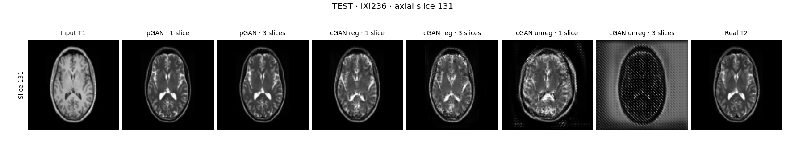

# Multi-contrast MRI Synthesis

Generate T2-weighted brain MRI slices from T1 images using PyTorch. This educational project compares six GAN configurations: paired pGAN and cycle-consistent cGAN with registered or unregistered training data, each using one or three input slices.

Experiments use the IXI dataset: **20 training, 4 validation, and 4 test subjects**, with **128 × 128** images and up to **20 training epochs**.

## Results

Held-out example showing the input T1, all six predictions, and the real T2 reference:



Scores cover 80 selected slices from four test subjects, averaged within subjects and then across subjects. Metrics include padding and background.

| Model | MAE ↓ | PSNR (dB) ↑ | SSIM ↑ |
|---|---:|---:|---:|
| pGAN, 1 slice | 0.0239 | 24.94 | 0.9055 |
| pGAN, 3 slices | 0.0237 | 25.03 | 0.9079 |
| cGAN registered, 1 slice | 0.0466 | 18.78 | 0.6956 |
| cGAN registered, 3 slices | 0.0486 | 18.60 | 0.6717 |
| cGAN unregistered, 1 slice | 0.0792 | 15.93 | 0.3852 |
| cGAN unregistered, 3 slices | 0.2824 | 10.00 | -0.0244 |

The three-slice pGAN performed best; the three-slice unregistered cGAN produced severe artifacts. These small-data results do not reproduce the published benchmark or establish clinical reliability.

## Get started

Use **Python 3.11 or 3.12**. Run these commands in the project directory (PowerShell):

```powershell
python -m venv .venv
.\.venv\Scripts\Activate.ps1
python -m pip install -r requirements.txt
```

The training launcher requires CUDA; install a matching [CUDA-enabled PyTorch build](https://pytorch.org/get-started/locally/) if needed. Evaluation also supports CPU.

Download and extract the [IXI T1 and T2 scans](https://brain-development.org/ixi-dataset/) into `data/raw`, then prepare the selected subjects and cache the pretrained VGG16 weights:

```powershell
python -m mri_synthesis.preparation
python -c "import torch; torch.hub.load_state_dict_from_url('https://download.pytorch.org/models/vgg16-397923af.pth', map_location='cpu', check_hash=True)"
python train_quick.py          # Check readiness
python train_quick.py --start  # Train the six models
```

Inspect registration previews before training. **Datasets and trained checkpoints are excluded from Git**; the figures and metric snapshot are included.

## Evaluate and explore

After training, evaluate the models and generate the image gallery:

```powershell
python test_models.py --device cuda
python visualize_all.py --device cuda
```

Find scores in `results/quick/summary_test.csv` and browse `results/quick/all_examples/index.html`. For CPU evaluation, use `--device cpu`. Launch optional MLflow tracking with `.\mlflow_ui.ps1`.

- [Training guide](docs/QUICK_START.md)
- [Testing, metrics, and inference](docs/TESTING.md)
- [Full metric snapshot](docs/assets/test_metrics.csv)

## References and attribution

Based on section 8.3.1 of *Deep Learning for Medical Image Analysis*, second edition, and [Dar et al. (2019)](https://doi.org/10.1109/TMI.2019.2901750). See the [authors' implementation](https://github.com/icon-lab/pGAN-cGAN).

Images are adapted from the **IXI Dataset** (Information eXtraction from Images, EPSRC GR/S21533/02). Adapted figures are shared under [CC BY-SA 3.0](https://creativecommons.org/licenses/by-sa/3.0/); see [asset attribution](docs/assets/README.md).
